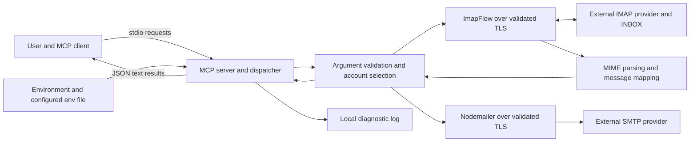

# Security assurance review — 31 October 2026

This review covers the supplied email-smtp-imap-mcp 2.2.1 release from commit [`c2c1056d48f980f7dec943b3bda5c43e9218bf49`](https://github.com/samihalawa/email-smtp-imap-mcp/tree/c2c1056d48f980f7dec943b3bda5c43e9218bf49). The [GitHub release](https://github.com/samihalawa/email-smtp-imap-mcp/releases/tag/v2.2.1), [npm package](https://www.npmjs.com/package/email-smtp-imap-mcp/v/2.2.1), source-bound evidence and provenance are available. The original finding baseline was commit `19eb6fb79e7cd36a608e09d9fe3cc5917f91f1da`. This post-release assessment supplements the immutable package and build archive; it does not change their contents. The [programme review](evidence/programme-review.md) records the separate ISO/IEC 18974 self-conformance assessment and its scope.

## System design: actors and interactions

The runtime is a local Node process launched by an MCP client. It exposes a stdio MCP interface, not an HTTP service. The MCP client is trusted to request actions against the accounts made available to that process. Mail servers and message contents are external inputs. The [tool reference](tool-reference.md) documents all six callable tools, their arguments, responses and error/partial-result behavior; the [README](../README.md) documents launch and account/environment configuration.

| Actor or component | Actions, data and trust boundary |
| --- | --- |
| Programme maintainer and local operator | Configure accounts and sender aliases; select the MCP client and provider endpoints; review changes, advisories, releases and permissions. Operating-system access to the process/configuration is part of the trust boundary. |
| MCP client and its user | Launch the server, discover schemas with `tools/list`, invoke `tools/call`, choose account/recipients/message data and consume results. Connected clients can use the configured tools; the server does not add a separate per-user login or infer permission from email content. |
| Environment loader and account manager | Read process variables and `.env` or `EMAIL_ENV_FILE`; existing variables take precedence. Parse account JSON/aliases, validate ports/booleans/required fields and choose the requested or default account. Configuration contains outbound provider credentials. |
| MCP server and handlers | Advertise the six schemas, dispatch calls, validate arguments, invoke services and wrap JSON responses in MCP text content. Failures set `isError`; configuration and provider errors become error results. Unknown tools are rejected. |
| ImapFlow and external IMAP provider | Authenticate using the selected account over implicit TLS or required STARTTLS. Search/fetch INBOX messages by UID, read bodies/attachments, list folders/status counts, change flags and move messages. Provider responses and MIME data cross into the local process. |
| Mailparser and message mapping | Parse fetched MIME sources into body/attachment objects and map envelope/flag/body-structure data into the documented response. Message bodies and attachments remain external data returned to the client or included in an explicitly requested reply/forward. |
| Nodemailer and external SMTP provider | Construct new, reply or forwarded messages, apply sender selection, recipients, threading and decoded attachments, authenticate and transmit over validated TLS. A successful SMTP result is not proof of inbox delivery. |
| Node TLS/OpenSSL, DNS and trust store | Resolve configured hosts, verify certificates/host identity and enforce TLS 1.2, minimum 2048-bit DH parameters and security level 2. SMTP/IMAP services rely on these cryptographic implementations instead of implementing their own cryptography. |
| Operating system and local filesystem | Supply environment/files and process permissions. Runtime diagnostics are appended under the operating-system temporary directory. The server's logging path is separate from MCP stdout; it is not an email-history database or an additional remote interface. |
| Contributors, GitHub and release tooling | Propose/review version-controlled changes; run TypeScript, tests, Semgrep and dependency checks; generate the npm tarball, component/source records and recovery archives. Registry inputs are pinned by the lockfile and archived with integrity checks. |
| npm registry, GitHub release storage and attestation services | Distribute the package and retained evidence; expose registry integrity, source/build provenance and component attestations for verification. These delivery identities and records are separate from runtime mail-provider authentication. |

Tool actions are bounded as follows:

| Tool | Runtime interaction |
| --- | --- |
| `accounts_list` | Load configuration and return account summaries without provider credentials; no mail-server connection. |
| `emails_find` | Select an account, construct IMAP conditions, search/fetch INBOX data, optionally parse bodies/attachments and return a limited message array. Returned counters describe that array, not the whole mailbox match population. |
| `folders_list` | Connect to IMAP, list folder paths and optionally request per-folder counts. A failed count request can leave that folder's counts absent. |
| `emails_modify` | Validate numeric UIDs and requested changes, then apply flags and/or a destination move per UID. Changes are not transactional; partial changes/errors are returned explicitly. |
| `email_send` | Validate message inputs, select the sender, decode supplied attachment data and send through SMTP. |
| `email_respond` | Fetch the original INBOX message by exact UID, choose reply/reply-all/forward recipients, optionally retain original content/attachments and send through SMTP. |

## Security risk assessment

This qualitative assessment considers the likely trust-boundary failures and their potential impact in the local-client deployment described above. Impact ratings are programme assessments, not assigned CVSS scores or a claim that each threat is an exploitable vulnerability. The evidence includes the source review, known-advisory review, Semgrep results and actual protocol/validation regression tests. It is not a penetration-test or exhaustive fuzzing result.

| Threat and potential impact | Controls and observed evidence | Residual conditions and disposition |
| --- | --- | --- |
| Network interception, TLS downgrade or weak DH parameters — high confidentiality/integrity impact on provider credentials and mail | Required STARTTLS or implicit TLS, certificate verification, TLS 1.2 minimum, DH 2048 minimum and OpenSSL level 2. Tests reject absent STARTTLS, untrusted certificates and 1024-bit DHE; a deliberately weakened control first establishes that the weak-DHE test server can negotiate. | The identified missing-policy defects were remediated before the supplied release. Provider/CA trust and operating-system integrity remain environmental dependencies. |
| Malicious or compromised dependency/build input — high supply-chain impact | Exact lockfile, integrity-checked archives, known-advisory remediation, public source review, static analysis, tests, empty-cache offline recovery and package/source provenance. The final dependency audit reports zero known findings. | Detection is limited to available advisory/analysis coverage; future disclosures require the documented post-release process. No unsupported non-exploitability waiver was used to clear the recorded dependency findings. |
| Untrusted MCP client or unintended tool invocation — high confidentiality/integrity impact | Local stdio transport and explicit tool/account arguments define the invocation boundary. Configured account selection, sender allowlists, UID validation and documented mutation/error semantics constrain individual operations. | Any connected client has the tools' configured account capabilities. The operator must trust that client/process and scope the accounts made available. This intended deployment boundary is not a remote authentication or per-user authorisation service. |
| Hostile MIME content, oversized messages or attachments — medium local availability/content-handling impact | Updated parsing/protocol components, structured output, bounded message count and configurable requests to include bodies/attachments. The server treats message content as data rather than commands. | A message-count limit is not a per-message byte limit; MIME parsing and base64 content can consume substantial memory. Clients should request only needed content and protect their own rendering/model/tool-use boundary. No claim of exhaustive parser fuzzing or a universal content-size bound is made. |
| Account, sender, recipient or UID confusion — medium confidentiality/integrity impact | Account validation, allowlisted sender selection where configured, exact numeric UIDs, reply recipient de-duplication and removal of the account's added aliases. Tests cover default account/sender behavior, false-valued filters, exact UID retrieval and reply-all construction. | UID scope is account/INBOX-specific and can change after a move. Explicit recipient overrides and SMTP acceptance require caller interpretation; the API does not certify address ownership or recipient delivery. |
| Configuration or diagnostic exposure on the local machine — medium confidentiality impact | Credentials are loaded from operator-controlled environment/files, are not included in account summaries and are excluded from committed env files. IMAP raw logging is disabled; normal server logging stays off MCP stdout. | Provider/configuration error details and temporary diagnostic logs require local access controls. This review does not claim comprehensive diagnostic redaction or encrypted storage of outbound provider passwords. |

The confirmed transport-policy and known dependency findings have recorded remediation and regression evidence below. The residual conditions above are documented limits of the scoped local-tool design; they are not hidden customer risk acceptances or evidence that the software is free of vulnerabilities. Material new findings follow the programme's severity/exposure assessment and release-blocking rules.

## Findings and remediation

| Finding | Assessment | Decision and evidence |
| --- | --- | --- |
| SMTP could authenticate without TLS when STARTTLS was unavailable | High project exposure: account secrets/message data could cross an unencrypted channel | Require STARTTLS, TLS 1.2 and valid certificates. Retain implicit TLS. Negative loopback test observes no AUTH command; positive end-to-end tests exercise both TLS modes. |
| IMAP `secure: false` permitted opportunistic STARTTLS; TLS error advised toggling encryption | High project exposure: downgrade could expose mailbox credentials | Require STARTTLS before authentication; retain implicit TLS default. Validate TLS 1.2/certificates. Replace insecure recovery advice. Downgrade and invalid-certificate tests fail closed; actual protocol tests complete both TLS modes. |
| Base lockfile had 14 affected packages (5 moderate, 8 high, 1 critical) | Advisory/package severity aggregation, not 14 demonstrated exploitable application defects | Reused only the security dependency changes authored by Nils Dedner / Claude Sonnet 5.5 in PR18 commits `418c1c69bf60b0b419d60fe7f85067ab9d866303` and `2be80894327c3a0b39c8b3df1c877b52dbc89936`. No PR17 mailbox features were imported. Updated MCP SDK to 1.32.2, mailparser to 3.12.4, Nodemailer to 10.2.1 and their resolved graph. |
| Reused PR18 lock retained newly reported GHSA-rmxm-3fg6-px4f, moderate, CVSS 5.3 | Hono adapter serveStatic decoding advisory; no application HTTP transport is initialized here, but no blanket non-exploitability exception is asserted | Targeted `npm audit fix --ignore-scripts` updated only @hono/node-server 2.1.0 to 2.1.5. Final audit reports zero known vulnerabilities. Baseline details and per-component remediation decisions are in [the evidence directory](evidence/vulnerability-review.json). |
| Component provenance and archive/recovery evidence were missing | Release-assurance process gap | Implemented and executed `npm run assurance`: SPDX output; all 175 lock component records and origins; 171 unique integrity-verified registry tarballs, including optional platform/build inputs; source manifest/archive; exact package files; empty-cache offline install and full test recovery. Unknown supplier identities are explicit SPDX NOASSERTION, not invented authors-as-suppliers. |

The complete baseline audit is retained in [base-audit.json](evidence/base-audit.json). All reported base components were updated/remediated; no customer exception or accepted residual advisory risk was needed. Per-component current decisions are emitted into the generated component record. Audit results are limited to publicly known advisories available at execution time.

## Verification and repeatable evidence

`npm test` builds successfully and passes all 21 tests under Node 26.9.0 / npm 12.1.0. Real loopback end-to-end runs cover SMTP STARTTLS plus IMAP implicit TLS and the complementary SMTP implicit plus IMAP STARTTLS. Separate tests reject absent STARTTLS before either protocol sends credentials, reject untrusted SMTP/IMAP certificates and check the minimum TLS/certificate settings. Both transports explicitly require 2048-bit Diffie–Hellman parameters and OpenSSL security level 2 while preserving Node’s default cipher list. A loopback regression first proves that a trusted test server can negotiate 1024-bit DHE under a deliberately weakened control policy, then verifies that both application transports reject it even when the process cipher defaults are weakened. This enforces a minimum 112-bit security strength under OpenSSL’s level-2 policy. Legacy TLS versions and every possible certificate-error variant are not exhaustively tested. See the [Node 20 TLS contract](https://nodejs.org/docs/latest-v20.x/api/tls.html#tlsconnectoptions-callback) and [OpenSSL security levels](https://docs.openssl.org/3.0/man3/SSL_CTX_set_security_level/).

Semgrep Community Edition 1.183.0 with `p/javascript`, `p/nodejs`, `p/security-audit` and three local transport rules scans all eight application TypeScript files and the JavaScript release-evidence script (nine files total): 92 applicable rules, approximately 100% parsed, zero final findings/errors. The local rules reproduce two baseline missing-transport-policy findings and clear after the fixes without suppressions. Community rules alone did not catch those missing policies. No paid engine/account is used. Registry rules can evolve; retained results include the rule IDs and executed version. The source-SHA CI artifacts expire after 90 days; release evidence must be retained durably.

The assurance script generates `release-artifacts/source-manifest.json`, `audit.json`, `semgrep.json`, `tests.txt`, `sbom.spdx.json`, `components.json`, package files/tarball, source/dependency archives, `recovery.json`, `recovery-tests.txt` and SHA-256 checksums. It verifies archive bytes against lockfile integrity, recovers every source hash, seeds an initially empty npm cache from only the archived tarballs, performs `npm ci --offline --ignore-scripts`, and reruns all 21 tests. Any failed gate terminates the bundle build. Generated binary assets stay outside Git and are intended as versioned release assets.

The actual supplier of this project is Sami. Upstream package metadata is retained as provenance; uncertain suppliers use [SPDX's explicit NOASSERTION representation](https://spdx.github.io/spdx-spec/v2.3.1/package-information/). Known unknowns are recorded rather than silently omitted or turned into a requirement for external supplier attestations. The programme uses the normative 2021 NTIA component-record model referenced by ISO/IEC 18974, not a claim of independent compliance with later procurement profiles.

`git diff --check` passes. A TypeScript ESLint-parser approach was discarded because its current peer contract excludes this project's intentional TypeScript 7.0.2; Semgrep avoids adding an incompatible development dependency. GitHub private vulnerability reporting is enabled, the repository is public, and authenticated advisory access was verified; no past reporter response is fabricated.

## Published-release verification

The [release build record](https://github.com/samihalawa/email-smtp-imap-mcp/actions/runs/41231099941) completed its source validation, build/evidence generation, offline recovery, package and SBOM attestations, and npm publication steps. Its later registry read-back step failed; subsequent registry integrity verification and GitHub release-asset read-back confirmed publication and retention. The overall workflow is not represented as a green run.

The release evidence records 48 source files, 175 component records, 171 unique dependency tarballs, 182 checksum entries, 21 passing tests, zero known audit vulnerabilities, zero Semgrep findings and successful empty-cache offline recovery. The source tree digest is `6aa5f83d2e8be4709db2a23b5183ede466623d0ac5976491d103964d204ab56c`, bound to the clean `c2c1056` source. The [retained archive](https://github.com/samihalawa/email-smtp-imap-mcp/releases/download/v2.2.1/release-assurance.tgz), [checksum record](https://github.com/samihalawa/email-smtp-imap-mcp/releases/download/v2.2.1/checksums.json) and [SPDX record](https://github.com/samihalawa/email-smtp-imap-mcp/releases/download/v2.2.1/sbom.spdx.json) are supplied with the release.

The published npm integrity is `sha512-zge1KsXDe95aGVj5iq0THPcb53gvmbba6/LYZxxdARtXR9Pkk7Bluudvdpe4LL8XKvhai0ofGvxRXaHJVu0XqQ==`. The [npm provenance](https://registry.npmjs.org/-/npm/v1/attestations/email-smtp-imap-mcp@2.2.1) identifies the same commit and GitHub-hosted workflow. GitHub retains [package provenance](https://github.com/samihalawa/email-smtp-imap-mcp/attestations/62170902) and the [SBOM attestation](https://github.com/samihalawa/email-smtp-imap-mcp/attestations/62170910). These attest the package/build and component information; an assertion covering every separately uploaded release asset requires its own verification record.

The release workflow uses reviewed source, validated version-tag input, standard npm tooling, public dependency inputs and GitHub-hosted attestations. npm registry authentication and GitHub OIDC attestation identity are distinct controls. The [programme review](evidence/programme-review.md) records the release-bound role, competence, assessed-awareness, resource and completeness review. Its self-conformance affirmation is not an external ISO certificate or evidence of OpenChain registration.
